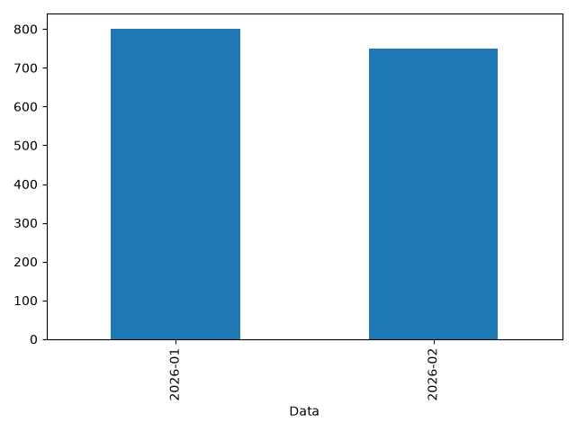

# Análise de vendas com Python

Projeto de portfólio que transforma um CSV em indicadores no terminal, um gráfico de faturamento mensal e um resumo mensal em CSV.

**Tecnologias:** Python, Pandas, NumPy, Matplotlib e unittest.

## Funcionalidades

- Validação de colunas, datas, campos vazios e valores numéricos.
- Cálculo de faturamento por registro, faturamento total e unidades vendidas.
- Agrupamento mensal em ordem cronológica, separando mês e ano.
- Relatórios estáticos, sem necessidade de abrir uma janela gráfica.
- Testes de cálculos e entradas inválidas no GitHub Actions.

## Executar

Use Python 3.12 ou 3.13 e Git.

~~~bash
git clone https://github.com/heldersegundo28/dashboard-vendas-profissional.git
cd dashboard-vendas-profissional
python -m venv .venv
~~~

Ative o ambiente no PowerShell:

~~~powershell
.\.venv\Scripts\Activate.ps1
~~~

No Linux/macOS, use `source .venv/bin/activate`.

~~~bash
python -m pip install -r requirements.txt
python main.py
~~~

A amostra didática de duas vendas deve gerar:

| Indicador | Resultado |
| --- | --- |
| Faturamento total | 1.550,00 |
| Unidades vendidas | 15 |
| Registros de venda | 2 |

Saídas: `images/faturamento.png` e `images/faturamento_mensal.csv`.

Para usar outra base:

~~~bash
python main.py --csv caminho/vendas.csv --output-dir relatorios
~~~

## Formato do CSV

| Coluna | Regra |
| --- | --- |
| Data | Data válida em AAAA-MM-DD |
| Produto | Texto não vazio |
| Categoria | Texto não vazio |
| Quantidade | Inteiro, finito e não negativo |
| Preco | Número finito e não negativo |

Use vírgulas como separador de colunas e ponto como separador decimal. Todos os preços devem usar a mesma moeda e unidade. Cada linha representa um registro de venda.

## Testes e organização

~~~bash
python -m unittest discover -s tests -v
~~~

Os testes cobrem os totais da amostra, meses e anos distintos e dados inválidos. A integração contínua também gera relatórios em Python 3.12 e 3.13.

- `src/analysis.py`: leitura, validação e cálculos.
- `main.py`: argumentos de execução e relatórios.
- `tests/`: regressões.
- `data/vendas.csv`: amostra didática.

## Limites

A interface é de linha de comando, com relatório estático. Não há painel web ou filtros interativos. A base incluída é apenas demonstrativa. Os cálculos usam ponto flutuante para análise exploratória, sem finalidade contábil.

Licença: [MIT](LICENSE).
